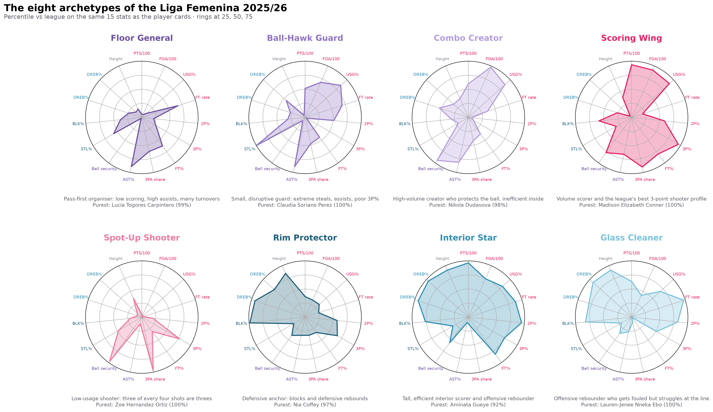
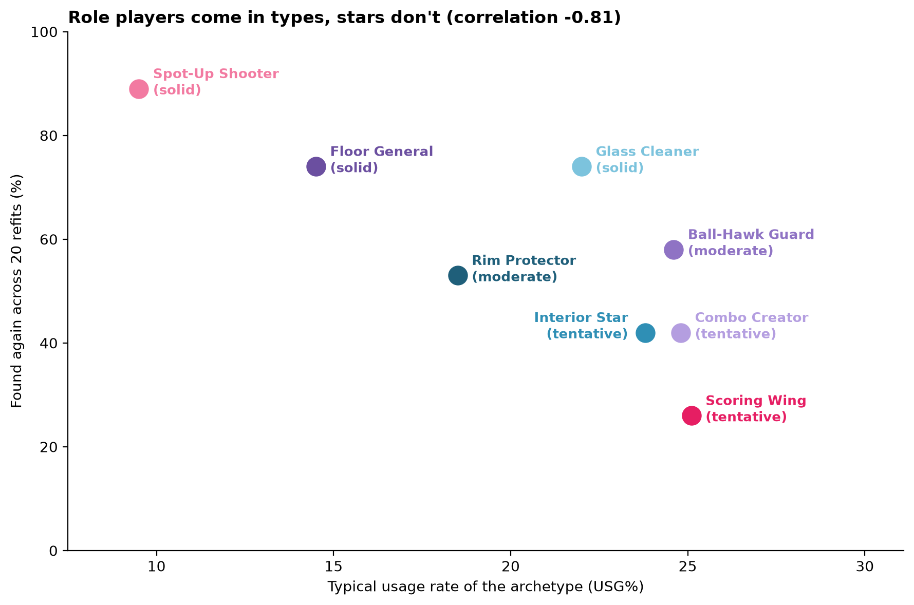
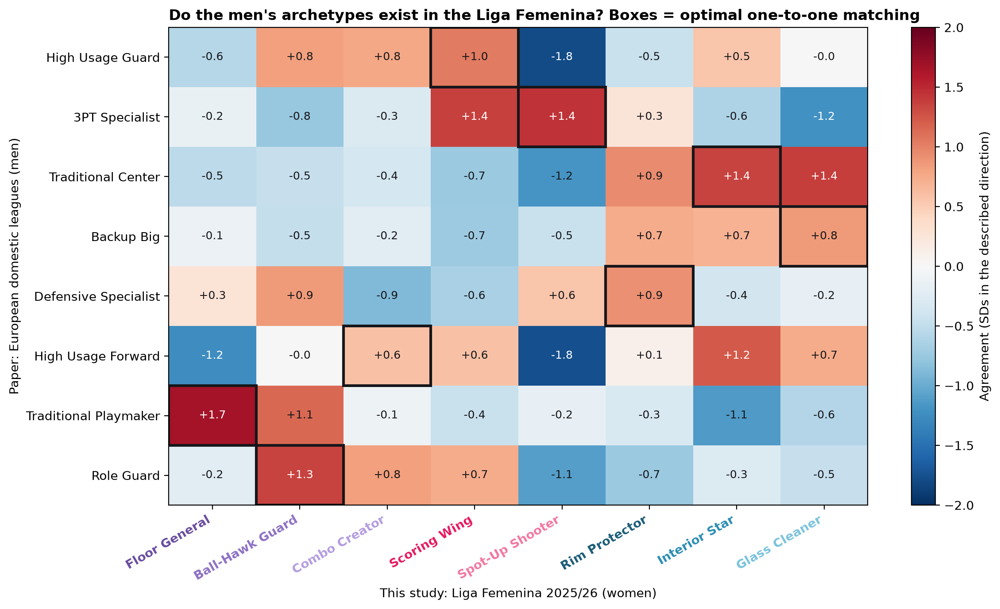
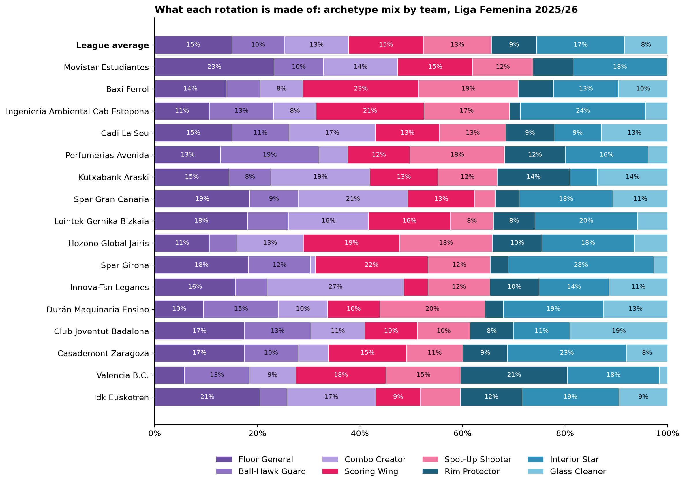
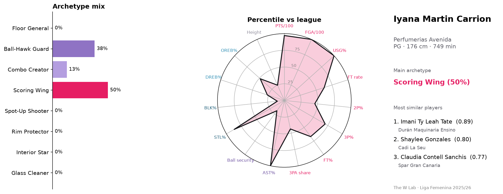
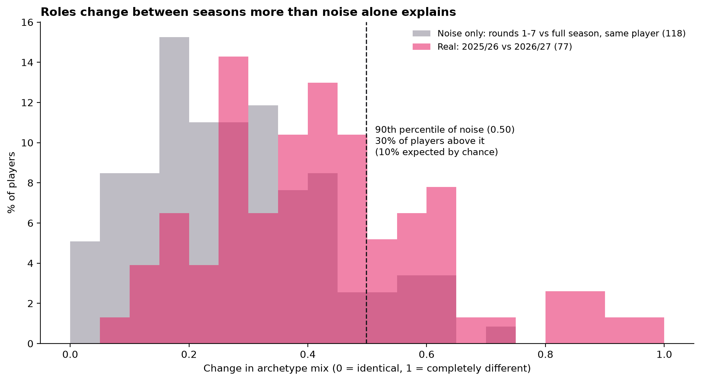

# Any League? Probabilistic Player Archetypes in Women's Basketball

**Replicating *Scouting Anyone* in the Liga Femenina Endesa**

**Tomás Costa** · MSc in Sports Analytics · Escuela Universitaria Real Madrid – Universidad Europea · November 2026

📄 **[Read the paper (PDF)](paper/Any%20League%20-%20Probabilistic%20Player%20Archetypes%20in%20Women%27s%20Basketball.pdf)** · 🗺️ **[Open the interactive league map](https://htmlpreview.github.io/?https://github.com/tomascosta7/any-league-archetypes/blob/main/figures/plotly/league_map_seasons.html)**

---

## The question

Positions no longer describe what basketball players do. *Scouting Anyone: Probabilistic Player Archetypes for Any League* (Myrte, Buzzalino and Aymerich, MIT Sloan Sports Analytics Conference 2026) replaces them with **archetypes**: extreme playing styles, of which every player is a mixture, built only from public box scores. The paper fits eight archetypes on men's European leagues and the NBA, and presents the method as valid *for any league*.

No women's league was tested. This project applies the paper's exact recipe to the Spanish **Liga Femenina Endesa** and asks:

1. Do the paper's archetypes exist in a women's league, and where do they differ?
2. Are the archetypes stable enough to trust when the model is refitted?
3. Do they hold when the frozen model is projected onto a new season (2026/27)?

## Key findings

- Archetypal Analysis on 15 box-score features finds **eight archetypes** in 142 player-team stints (2025/26), explaining **69.5%** of the variation (K-Means: 49.6%).
- **Role players come in types, stars don't:** stability across 20 refits falls with usage (r = −0.81), from 89% (Spot-Up Shooter) to 26% (Scoring Wing).
- The paper's **role-player archetypes transfer** to the women's game; the **interior and the creators are organised differently**, and the **Combo Creator has no men's counterpart**.
- **Players are mixtures:** 59% have no archetype above half of their mix.
- Projected to 2026/27 with the frozen model, **30% of players change role beyond a noise baseline** that only 10% would exceed by chance.

> **Answer to the title:** the *method* works for any league; the *archetypes* do not transfer as a fixed list. Refit the model on each league.

---

## The eight archetypes

| Archetype | Defining values | Purest player |
| --- | --- | --- |
| Floor General | 26.0% assist rate, 30.8% turnover rate, 14.5% usage | Lucía Togores (99%) |
| Ball-Hawk Guard | 6.1% steal rate, 26.2% assist rate, 170 cm | Claudia Soriano (100%) |
| Combo Creator | 23.7 shots per 100, 8.8% turnover rate, 39% from two | Nikola Dudasova (98%) |
| Scoring Wing | 28.0 points per 100, 39% from three, 25.1% usage | Madison Conner (100%) |
| Spot-Up Shooter | 9.5% usage, 75% of shots from three | Zoe Hernández (100%) |
| Rim Protector | 3.8% block rate, 22.1% defensive rebound rate | Nia Coffey (97%) |
| Interior Star | 29.1 points per 100, 56% from two, 13.8% offensive rebound rate | Aminata Gueye (92%) |
| Glass Cleaner | 10.9% offensive rebound rate, 0.53 free-throw rate | Lauren Ebo (100%) |

## Role players come in types, stars don't

The archetypes of low-usage role players reappear in almost every refit; those of high-usage scorers and creators do not.

## Comparison with the paper (men's European leagues)

| Paper (men) | Liga Femenina (women) | Agreement | Robust in |
| --- | --- | --- | --- |
| Traditional Playmaker | Floor General | +1.66 SD | 100% of variants |
| 3PT Specialist | Spot-Up Shooter | +1.44 SD | 91% |
| High Usage Guard | Scoring Wing | +1.04 SD | 88% |
| High Usage Forward | Interior Star | +1.23 SD | 100% (best match) |
| Defensive Specialist | Rim Protector | +0.91 SD | 94% (best match) |
| Traditional Center, Backup Big | Glass Cleaner | +1.38 / +0.85 SD | 91% (best match) |
| — | **Combo Creator** | no men's counterpart | — |

## Teams and players

Every rotation contains all eight archetypes; identity comes from one block worth about one player. **Valencia**, the 2025/26 champion, built from the rim out: 21% Rim Protector (league 9%) and almost no classic Floor General (6% vs 15%).

Each of the 142 stints has a player card ([all cards](figures/player_cards/)):

## 2026/27: real change or noise?

After seven rounds, noise alone flips the main archetype of 39% of players, so early-season labels are unreliable. The mix, however, moves more between seasons than noise explains (median 0.42 vs 0.25).

---

## Method

| Step | Notebook | What happens |
| --- | --- | --- |
| Data | `01_dados.ipynb` | Scrapes 296 games (2025/26 and 2026/27 rounds 1–7) from the FEB website; validates against official totals |
| Features | `02_model.ipynb` | 15 pace-adjusted features (Basketball-Reference formulas); shrinkage of shooting percentages; z-scores |
| Model | `02_model.ipynb` | Archetypal Analysis (K = 8, 20 starts) vs K-Means; stability across 20 refits (Hungarian matching); KNN; 2026/27 projection with a noise baseline |
| Results | `03_results.ipynb` | Archetype portraits, team fingerprints, 142 player cards, PCA league map (Plotly), comparison with the paper |

The notebooks are kept as a learning record: **errors and their fixes are left visible**, each followed by a note and the corrected cell. *Run All* therefore stops at the first intentional error; run the cells in order instead.

## How to reproduce

    conda env create -f environment.yml
    conda activate liga_femenina
    jupyter lab

Then run `01_dados.ipynb`, `02_model.ipynb` and `03_results.ipynb`, in that order.

## Repository

| Path | Content |
| --- | --- |
| `01_dados.ipynb`, `02_model.ipynb`, `03_results.ipynb` | The three notebooks |
| `figures/` | All figures, 142 player cards (`player_cards/`) and interactive Plotly maps (`plotly/`) |
| `paper/` | The paper (PDF) |
| `environment.yml` | Conda environment with exact package versions |

## Data

Data come from the official website of the Spanish Basketball Federation, [baloncestoenvivo.feb.es](https://baloncestoenvivo.feb.es). **The scraped data are not included in this repository**; `01_dados.ipynb` regenerates them, with a one-second pause between requests. The 2025/26 box scores of Movistar Estudiantes miss 372 points at the source; see the paper for details.

This is an independent academic project, not affiliated with the FEB or the Liga Femenina Endesa.

## Citation

> Costa, T. (2026). *Any League? Probabilistic Player Archetypes in Women's Basketball.* MSc in Sports Analytics, Escuela Universitaria Real Madrid – Universidad Europea. https://github.com/tomascosta7/any-league-archetypes

## Author

**Tomás Costa** · [LinkedIn](https://www.linkedin.com/in/tom%C3%A1s-costa-3a7a28242/) · [The W Lab](https://thewlab.github.io/the-w-lab/) (women's basketball analytics)
